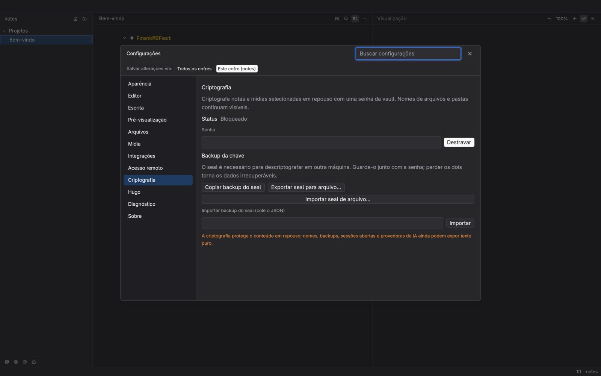
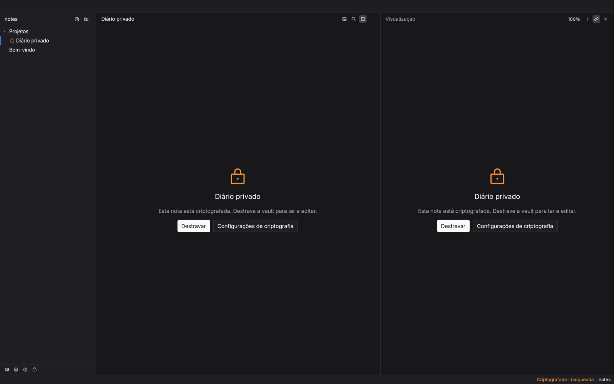
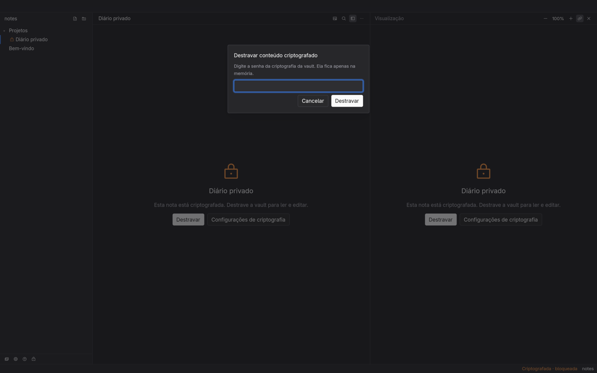
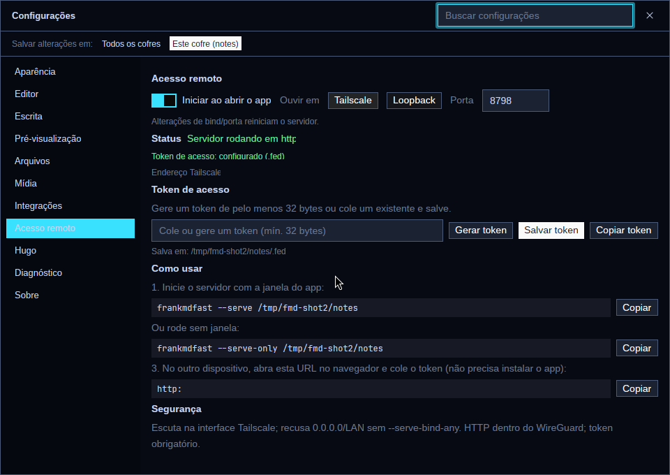

<p align="center">
  
</p>

<h1 align="center">FrankMDFast</h1>

<p align="center">
  A native Rust desktop rewrite of <a href="https://github.com/akitaonrails/FrankMD">FrankMD</a>,
  built with GPUI + gpui-kit and designed to fit in on Omarchy.<br>
  It aims to be a drop-in replacement: same <code>.fed</code> file, same environment variables, same notes on disk.
</p>

> **Fork notice** — This is a fork of
> [akitaonrails/FrankMDFast](https://github.com/akitaonrails/FrankMDFast),
> maintained by [ghpo](https://github.com/ghpo). Upstream is the original work;
> this fork adds opt-in Tailscale remote access and is **not affiliated with or
> endorsed by** the upstream author. See [FORK.md](FORK.md) for differences,
> sync and reporting rules.
>

<p align="center">
  
</p>

| Command palette | Settings | Light theme |
|---|---|---|
|  |  |  |

## Encryption at rest

Encrypt **selected notes and media** with one vault password
(Argon2id + XChaCha20-Poly1305). Filenames stay visible; content is sealed.
Create/unlock/lock and back up the seal in **Settings › Encryption**; right-click
a note to **Encrypt/Decrypt** — the note and every local attachment it references
are encrypted/decrypted together. Use **Encrypt attachments of encrypted notes**
for notes encrypted by older versions, and the media library for standalone
files. Shared attachments stay encrypted while another encrypted note uses
them; with the vault unlocked, encrypted images are rendered through a private
temporary cache. The paperclip
in the preview header lists every local attachment of the note (images, video,
audio, PDFs, archives) with **Save as…** and **Save all…**. See
[docs/encryption.md](docs/encryption.md) for the format, key backup, password
rotation and limits.

<p align="center">
  
  
  
</p>

## Preview: copy, PDF and print

The preview header has **Copy formatted** (rich HTML plus plain-text fallback),
**Save PDF…** and **Print**. PDF and print render the same sanitized preview
HTML through headless Chromium; **Print** opens the generated PDF in the
default viewer, where you can choose a printer. These actions are disabled
while an encrypted note is locked.

## AI integration (including DeepSeek)

Open **Settings › Integrations** and choose **DeepSeek** as the provider; fill
**DeepSeek API key** and select **DeepSeek Chat** or **DeepSeek Reasoner**.
The **Save and test** button persists the pending key/model and sends a minimal
real request, showing whether the connection worked. DeepSeek models can also
be used through OpenRouter with the two preset buttons (your OpenRouter key is
used in that path).

## Remote access (Tailscale) — start it from Settings

<p align="center">
  
</p>

Serve this vault to a browser on another device on your Tailscale network,
without leaving the desktop app:

- **Settings › Remote → Start on app launch** — a per-machine preference that
  starts the server immediately and on every next launch (Tailscale or
  Loopback, editable port).
- **Access token right in the panel** — paste an existing token or click
  **Generate token**, then **Save token** and **Copy token**. The panel shows
  the exact destination: `.fed` (This vault) or the global config (All vaults);
  `FRANKMD_AUTH_TOKEN` overrides the file.
- **It keeps serving after you close the window** — the server runs as a
  detached `frankmdfast --serve-only` daemon; `SUPER+W` does not stop it.
  Settings › Remote has explicit **Start server** / **Stop server** buttons.
- **Start at login** — enable the systemd user unit from Settings › Remote to
  start the server when you log in. For boot before login, enable lingering.
- The browser editor has the file tree, autosave, live Markdown preview,
  search, settings, themes, media library/upload and AI actions.
- Authentication is a mandatory token of at least 32 bytes (`auth_token` in
  `.fed`, `FRANKMD_AUTH_TOKEN`, or `--serve-token`).
- Live updates over SSE. The same server can run headless (`--serve-only`) for
  a systemd user unit.

```bash
export FRANKMD_AUTH_TOKEN="$(openssl rand -hex 32)"
frankmdfast --serve ~/notes        # desktop window + remote server
# or headless: frankmdfast --serve-only ~/notes
# then open http://<tailscale-ip>:8787 and paste the token
```

**From another machine:** install Tailscale there, open
`http://<tailscale-ip>:8787` in a browser and paste the token. No FrankMDFast
install is needed — the browser is the remote client. If you want the native
desktop app on the other machine, mount the notes folder with SSHFS and open it
locally (there is no native remote-client mode yet).

The default bind is the Tailscale address; `0.0.0.0`/LAN requires
`--serve-bind-any`. See [docs/remote.md](docs/remote.md) for the security
model, HTTP API and the systemd unit.

---


## Install

To use **this fork** (with remote access), build it from source:

```bash
cargo build --release -p frankmd-app
# binary: target/release/frankmdfast
```

Requirements: Rust 1.92+ and the GPUI Linux dependencies documented by the
upstream project.

The upstream desktop app is available from
[upstream Releases](https://github.com/akitaonrails/FrankMDFast/releases) and the
`frankmdfast-bin` AUR package. Those packages do **not** include this fork's
remote-access changes.

## Status

Every domain crate is implemented and passes its ported FrankMD tests and golden cases. The GPUI
app has the shell, the editor, the native preview and the dialogs (files, media/AI, insert).
Development happens on `master`; CI builds every push.

```
cargo test --workspace     # 2901 tests
cargo run -- ~/notes       # open a notes folder (or a single note)
```

Known gaps: relative line numbers; typed insert-mode text after `cw` takes a second undo; Hebrew
has no right-to-left layout yet (GPUI has no bidi); settings "Test connection" buttons; secrets
in the global config file are plain text (0600), with no keyring yet. On Windows a second launch
opens a new window instead of reusing the running app. The full test suite runs on Linux; Windows
CI also runs the Windows-only path and vault tests, and macOS CI checks that it builds.

## Releases

Bump `version` in `Cargo.toml`, optionally add `releases/vX.Y.Z.md` (used as the release notes),
then push the tag `vX.Y.Z`. `.github/workflows/release.yml` builds:

| Platform | Files |
|---|---|
| Linux x86_64, aarch64 | `frankmdfast-X.Y.Z-linux-<arch>.tar.gz`, `FrankMDFast-X.Y.Z-<arch>.AppImage` |
| macOS (universal) | `FrankMDFast-X.Y.Z-macos-universal.dmg` |
| Windows x86_64 | `frankmdfast-X.Y.Z-windows-x86_64.zip`, `FrankMDFast-X.Y.Z-windows-x86_64-setup.exe` |
| Arch Linux | AUR package `frankmdfast-bin`, pushed after the GitHub release |

Running the workflow by hand builds everything as artifacts without publishing. Signing,
notarization and the AUR push are optional and turn on when their secrets exist:

| Secret | Used for |
|---|---|
| `AUR_SSH_PRIVATE_KEY` | Pushing `frankmdfast-bin` to the AUR |
| `MACOS_CERTIFICATE`, `MACOS_CERTIFICATE_PASSWORD`, `MACOS_SIGNING_IDENTITY` | Developer ID signing (base64 `.p12`) |
| `APPLE_ID`, `APPLE_APP_PASSWORD`, `APPLE_TEAM_ID` | Notarizing the DMG |
| `WINDOWS_CERTIFICATE`, `WINDOWS_CERTIFICATE_PASSWORD` | Authenticode signing (base64 `.pfx`) |

Packaging scripts live in `packaging/` and run locally too, e.g.
`packaging/linux/package.sh 0.1.0 x86_64 target/release/frankmdfast dist`.

## How the rewrite is checked against the original

1. **Ported tests.** Every logic and integration test from FrankMD's Ruby and JS suites is ported
   one for one. Each carries a `// port: <original file>:<line> "<name>"` comment.
   Rails-only tests are listed as skipped, with the reason. Per-area tables are in `docs/testing/port-*.md`.
2. **Recorded outputs.** `tests/fixtures/golden/` holds 7,534 input/output cases (53 files)
   produced by running the original Ruby and JS code. They cover the byte-exact `.fed` template,
   config resolution, paths, Hugo slugs, search and the markdown pipeline.
   `tools/golden/regen_all.sh` regenerates them from a FrankMD checkout.
3. **UI tests.** The 1,418 browser/system tests are adapted to the new design in
   `docs/testing/ui-test-plan.md`. Most become GUI-free view-model tests; the rest run headless in GPUI.

## Docs

| Doc | What |
|---|---|
| [docs/inventory/backend.md](docs/inventory/backend.md) | Every backend feature, config key and ENV var (BE-001…BE-100) |
| [docs/inventory/frontend.md](docs/inventory/frontend.md) | Every UI feature, shortcut, dialog and theme (FE-001…FE-503) |
| [docs/inventory/test-contracts.md](docs/inventory/test-contracts.md) | What each original test guarantees, by category |
| [docs/research/history-pain-points.md](docs/research/history-pain-points.md) | Recent git history: recurring bugs, security fixes, do/don't (HP-001…HP-030) |
| [docs/research/omarchy-4.5.md](docs/research/omarchy-4.5.md) | Omarchy 4.5 theming, fonts, language, IME, desktop integration (OM-001…OM-028) |
| [docs/research/components.md](docs/research/components.md) | Crate research and GUI stack comparison |
| [docs/research/gpui-stack.md](docs/research/gpui-stack.md) | GPUI/gpui-kit specifics and how we fill its gaps |
| [docs/architecture.md](docs/architecture.md) | Crate layout, domain rules, threading, config model |
| [docs/design/ui-spec.md](docs/design/ui-spec.md) | UI/UX spec; mockups in [docs/design/mockups/index.html](docs/design/mockups/index.html) |
| [docs/testing/](docs/testing/) | Porting reports and the UI test plan |
| [assets/README.md](assets/README.md) | Assets reused from FrankMD (logo, themes, icons, emoji, locales) |

## Decisions so far

| Decision | Why |
|---|---|
| GPUI + gpui-kit `=0.9.0` (exact pin) | Chosen over GTK4. Weekly breaking 0.x releases, so only `frankmd-app` depends on it |
| Config resolves `.fed` > ENV > default, exactly as the original | Drop-in compatibility |
| Theme and language follow Omarchy live unless `.fed` (or the global config / ENV) pins them | Picking "Follow Omarchy" or "System" in the pickers removes the pin. Language order: explicit setting > `~/.config/omarchy/language` > `LC_*`/`LANG` > English |
| Interface size (80–200%) is an app preference in `~/.local/state/frankmdfast/prefs.json`, not a `.fed` key | It belongs to the machine, and FrankMD's `.fed` schema stays unchanged |
| Recent files stay in `.fed`; Hugo dates stay UTC | Same on-disk behavior, so switching between the two apps keeps your history |
| Drafts keyed by stable note ID, not path | Fixes the path-as-identity bug class from the history. Browser drafts were never readable by a desktop app anyway |
| Omarchy theme from `~/.local/state/omarchy/current/theme/colors.toml` | The original's path no longer exists, so its theme sync is broken today |
| No RTL mirroring in v1 | GPUI has no bidi yet. The original never mirrored either, so nothing regresses |
| Vim is our own state-machine crate | gpui-kit's editor has no vim layer |
| Delete goes to the system trash | Also fixes the original's failing delete of non-empty folders |
| Preview line mapping and Dockerfile highlighting fixed | Both were bugs in the original |

### Security decisions (diverge from the original on purpose)

Security comes first. Where the original's behavior is unsafe, we change it and mark the affected
tests and recorded cases with `// security:`.

- **Uploads accept only real media files.** Content is sniffed (magic bytes) and must match an allowed
  image/video type. The extension alone is not trusted.
- **URLs with userinfo (`user:pass@host`) are rejected** by the egress policy.
- **AI requests never include config or secrets.** The grammar check only accepts markdown note content and
  refuses `.fed` and other non-note files.
- **In-app `.fed` editing stays blocked** (as in the original since its security fix). Settings are edited
  through the Settings sheet, which never displays stored secrets.

## Layout

```
crates/
  frankmd-core       domain model: identity, paths, tree, slugs, Hugo, wikilinks, text ops   (no IO)
  frankmd-fs         the only crate that writes to disk: atomic, no-clobber, locks
  frankmd-config     .fed parse/write-back, ENV, resolution
  frankmd-theme      built-in, custom and Omarchy themes
  frankmd-i18n       reads the Rails YAML locales unchanged
  frankmd-markdown   marked port → IR for the native preview; HTML only as a test oracle
  frankmd-search     content search (Ruby regex semantics), find/replace
  frankmd-net        the one HTTP client, with egress (SSRF) policy
  frankmd-media      uploads, S3, library, usage, image/video search
  frankmd-ai         grammar fix and image generation across 5 providers
  frankmd-vim        vim state machine
  frankmd-watch      notes dir + Omarchy theme watching
  frankmd-workspace  app state, autosave, drafts, commands (GUI-free view models)
  frankmd-app        GPUI shell
  frankmd-testkit    test helpers for the recorded outputs
assets/              reused FrankMD assets
packaging/           Linux (tarball, AppImage), macOS, Windows and AUR packaging
tests/fixtures/      recorded outputs from the original
tools/               generators for fixtures and assets
```
