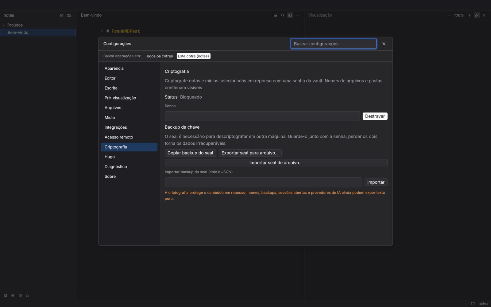
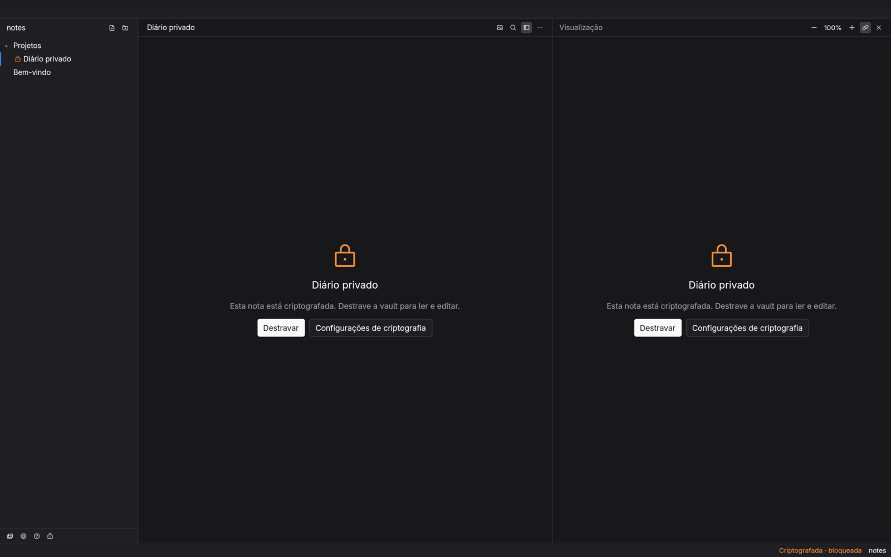

# Encryption at rest (notes and media)

FrankMDFast can encrypt **selected notes and media files** at rest with one
per-vault password. Filenames, folder names, sizes and mtimes stay visible;
the content is sealed.

<p align="center">
  
  
</p>

## Quick start

1. Open **Settings › Encryption** (`Ctrl+,`, or the palette command
   **Encryption settings**).
2. Create a key: choose a password with **at least 12 characters** and confirm.
3. Right-click a note in the tree and choose **Encrypt note** (or
   **Decrypt note** if it is already encrypted). The tree shows an open or
   closed padlock in front of the name.
4. Media: open the **Media Library**, pick a card and use **Encrypt** /
   **Decrypt**.
5. Lock or unlock from the padlock button at the bottom of the sidebar (next
   to Media library, Settings and Help), or with **Lock** in Settings. Locking
   shows the padlock content view for encrypted notes; plain notes keep
   working. There is no global keyboard shortcut for lock/unlock.
6. Clicking a locked note shows a padlock panel with **Unlock**; the quick
   unlock dialog asks for the password and reopens the note.

## Cryptography

- **KDF**: Argon2id (m=64 MiB, t=2, p=1) over a 16-byte random salt.
- **AEAD**: XChaCha20-Poly1305 with a fresh 24-byte nonce per file.
- **Seal** (`<per-vault state>/encryption.json`): salt, KDF parameters and an
  encrypted verifier. It contains **no password and no key**.
- **Notes** keep the `.md` name and gain a text envelope:
  ```
  -----BEGIN FRANKMD ENCRYPTED-----
  {"v":1,"alg":"xchacha20poly1305","nonce":"…"}
  <base64 ciphertext>
  -----END FRANKMD ENCRYPTED-----
  ```
- **Media** keep the name and gain the binary `FRANKMDENC1` header.
- The key exists only in memory, is zeroized on **Lock**/exit, and is never
  written to disk or logs.

## Backup the seal

The seal is required to decrypt on another machine. Use **Copy seal backup** in
Settings and store the JSON with the password (password manager, USB, …). Use
**Import seal backup** to restore it. **Losing both the password and the seal
makes the data unrecoverable** — there is no recovery key.

Use **Export seal file…** to save the seal JSON to a file, and **Import seal
file…** to restore it (the existing clipboard copy/paste remains). Importing
over an existing seal asks for confirmation; back up the current seal first.

The seal lives outside the synced vault, so a git clone/sync of the vault alone
cannot decrypt it; copy the backup to the other machine.

**Losing only the seal is also fatal after the app is restarted** (unless you
have a file/state-dir backup or a snapshot): the random salt lives only in the
seal, so the password alone cannot derive the key. While the app is still
running the seal stays in memory: use **Export seal file…** (or **Copy seal
backup**) immediately, or change the password to generate a new seal and
re-encrypt. Creating a new key after the seal is gone does **not** recover the
old files.

## Change the password

**Change password and re-encrypt** derives a new key, rewrites every encrypted
note/media file atomically with the new key, and replaces the seal last. Run it
only when all edits are saved; it can take a while on large media. The remote
daemon reloads the new seal on its next status/unlock; re-unlock the web UI with
the new password.

## Per-note and per-media choice

Encryption is opt-in per file. Plain files are untouched and readable without
the key. Encrypting a note replaces the plaintext atomically; previous copies
in git history, editor backups, filesystem snapshots or cloud backups may still
contain plaintext. The same applies to media.

## Remote access

The web UI asks for the encryption password when it hits a locked note/media
(`423 locked`). The header lock button (`⚿`) locks the daemon key. The web
unlock is independent from the desktop session; the app's Settings unlock does
not unlock the daemon.

## Note attachments

The paperclip in the preview header lists every **local** file referenced by
the note: Markdown links, `![]` images, `<video>/<audio>/<source>` sources and
reference definitions. Links to other notes (`.md`), external URLs and `.fed`
are not listed. Clicks on an attachment link open this list instead of trying
to open the binary as a note.

Each row has **Save as…**; **Save all…** asks for a folder and writes every
attachment, adding ` (1)`, ` (2)` on name collisions rather than overwriting.
Encrypted media is saved decrypted; if the vault is locked, FrankMDFast asks
for the password first. The browser remote already serves non-note files from
`/api/asset`, so it downloads them normally.

## Search, drafts, AI, media previews

- **Search** for encrypted notes is by **filename only**. Content search skips
  them (a `423`/skipped entry), even when unlocked over the remote.
- **Drafts** are not written for encrypted notes (the encrypted note itself is
  autosaved); an unsaved crash recovery for them is not available.
- **AI** features need the note readable; be aware that the decrypted text is
  sent to the configured provider when you use them.
- **Media previews**: the media library shows a lock placeholder for encrypted
  files; decrypt a file to preview it. Media encryption is in-memory with a
  **512 MiB cap** (larger files are refused). S3/direct URLs and Hugo builds
  cannot read encrypted files; use local media and don't encrypt Hugo content.
- The quick-note plugin (Ctrl+Alt+N) writes plaintext; open the note in
  FrankMDFast and encrypt it afterwards.

## Threat model

Encryption protects the **content at rest** against someone copying the vault,
a synced repository or a backup. It does not protect against malware/keyloggers,
an unlocked session, a browser that has unlocked the remote, screenshots, or
metadata (filenames/folders).
