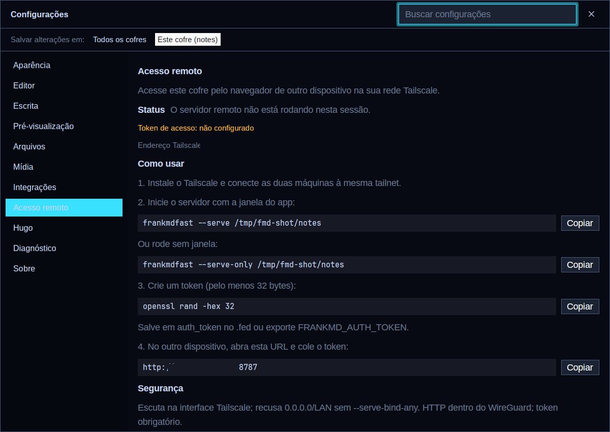

# Remote access (Tailscale + token)

FrankMDFast can serve the same notes vault to a browser on another machine.
The server is embedded in the `frankmdfast` binary (`frankmd-remote` crate) and
is **off unless you pass `--serve`**.

The web client is a dependency-free SPA embedded in the binary (no CDN, no
build step), so it works on an offline Tailscale network.

## Security model

| Layer | Rule |
|---|---|
| Binding | Default is the machine's **Tailscale** IPv4 address (`tailscale ip -4`). Loopback is allowed. `0.0.0.0` and public/LAN addresses are refused unless `--serve-bind-any` is passed. |
| Transport | Plain HTTP **inside** Tailscale's WireGuard tunnel. Do not use `--serve-bind-any` on an untrusted network. |
| Authentication | Mandatory token of at least **32 bytes**. There is no "no auth" mode. |
| Credentials | `Authorization: Bearer <token>`, `X-Auth-Token: <token>`, or the session cookie `frankmd_auth_token_digest=<sha256hex(token)>` (HttpOnly, SameSite=Strict, 30 days). |
| Comparison | Constant-time over SHA-256 digests (`subtle`). |
| Brute force | 10 failures per IP / 100 global per 5 minutes → `429`. |
| CSRF | Cookie-authenticated mutations require `X-FrankMD-CSRF: 1` (the SPA sends it). |
| Headers | CSP, `nosniff`, `X-Frame-Options: DENY`, `Referrer-Policy: no-referrer`. |
| Path safety | Every note/folder request goes through `frankmd-fs` containment (symlink-aware). `.fed` and dotfiles are never exposed by the note API. |

### Token precedence

1. `--serve-token <token>`
2. `FRANKMD_AUTH_TOKEN`
3. `auth_token = ...` in the vault `.fed`
4. `auth_token = ...` in the global `config.toml`

Generate one with:

```bash
openssl rand -hex 32
```

## In the app

Open **Settings › Remote**. That panel shows whether the server is running in
the current session, the Tailscale address, whether a token is configured, and
copy-ready commands for the desktop, headless, token and URL steps. You can also
run the palette command **Remote access settings**.



## Quick start

Desktop window **and** remote server:

```bash
frankmdfast --serve ~/notes
# remote server ready url=http://100.69.202.87:8787
```

Headless server (no window, e.g. on a home server):

```bash
FRANKMD_AUTH_TOKEN="$(openssl rand -hex 32)" \
  frankmdfast --serve-only ~/notes
```

Open `http://<tailscale-ip>:8787` from another device and paste the token.

Loopback for an `ssh -L` tunnel:

```bash
frankmdfast --serve-only --serve-bind loopback --serve-port 8787 ~/notes
ssh -L 8787:127.0.0.1:8787 user@host
```

## Flags

| Flag | Default | Meaning |
|---|---|---|
| `--serve` | off | Serve the vault and open the desktop window. |
| `--serve-only` | off | Serve without GPUI; blocks until killed. |
| `--serve-bind <spec>` | `tailscale` | `tailscale`, `loopback`, `any`, or an IP. |
| `--serve-bind-any` | off | Allow `any` / a non-Tailscale address. Dangerous. |
| `--serve-port <port>` | `8787` | Also `FRANKMD_REMOTE_PORT`. |
| `--serve-token <token>` | — | Prefer `FRANKMD_AUTH_TOKEN` or `.fed`. |

`--serve` and `--serve-only` skip single-instance forwarding: a second
invocation starts its own server instead of handing its request to the running
window.

## systemd user unit (headless)

`~/.config/systemd/user/frankmdfast-remote.service`:

```ini
[Unit]
Description=FrankMDFast remote server
After=NetworkManager-wait-online.service tailscaled.service

[Service]
Type=simple
ExecStart=%h/.local/bin/frankmdfast --serve-only %h/notes
Environment=FRANKMD_AUTH_TOKEN=<paste the token>
Restart=on-failure
RestartSec=5

[Install]
WantedBy=default.target
```

```bash
systemctl --user daemon-reload
systemctl --user enable --now frankmdfast-remote.service
journalctl --user -u frankmdfast-remote -f
```

The token is a secret: prefer a `0600` environment file
(`EnvironmentFile=%h/.config/frankmdfast/remote.env`) over `Environment=` if you
care about `systemctl show`.

## Tailscale ACL suggestion

Restrict the port to your own devices (Tailscale admin → Access controls):

```json
{
  "grants": [
    { "src": ["autogroup:member"], "dst": ["autogroup:self"], "ip": ["*"] }
  ]
}
```

The server still requires the token; the ACL is defence in depth.

## Web UI

- Notes tree, create/rename/delete (delete moves to the OS trash), Hugo posts.
- Editor with autosave, optimistic concurrency (`expected_revision`), live
  preview rendered by the same `frankmd-markdown` IR as the desktop app.
- Content search (Ruby-regex semantics, literal fallback) and fuzzy quick open.
- Shared recents (`.fed recent_files`), settings (`PATCH /api/config`), themes
  (built-in, Omarchy palette, custom), translations.
- Media: multipart/base64 uploads, library, insert, delete; S3 when configured.
- AI: grammar fix and image generation when a provider key is configured.
- YouTube search.
- Live updates over SSE (`/api/events`) from the vault watcher.

## HTTP API

All endpoints except `/up` and `/login` require authentication. JSON in/out.
Paths in the URL are vault-relative and may contain `/`.

| Method | Path | Notes |
|---|---|---|
| GET | `/up` | health, no auth, CORS `*` |
| GET/POST | `/login`, `/logout` | form login, session cookie |
| GET | `/api/session` | vault, version, uptime |
| GET | `/api/tree` | Explorer tree |
| GET | `/api/note?path=` | `{path, content, revision, valid_utf8}` |
| POST | `/api/note` | create, no-clobber |
| PATCH | `/api/note` | `{path, content, expected_revision?}`, never creates |
| DELETE | `/api/note?path=&expected_revision=` | move to trash |
| POST | `/api/note/rename` | `{path, new_path}` |
| POST/DELETE | `/api/folder` | create / trash |
| POST | `/api/folder/rename` | rewrites the Hugo slug |
| POST | `/api/hugo` | `{parent?, title, slug?}` |
| POST | `/api/preview` | `{content}` or `{path}` → sanitized HTML |
| GET | `/api/asset/{*path}` | raw vault file (images) |
| GET | `/api/search?q=` | content search |
| GET | `/api/finder?q=` | fuzzy quick open |
| GET/POST/DELETE | `/api/recent` | shared recents |
| GET/PATCH | `/api/config` | UI keys, all-or-nothing |
| GET | `/api/config/editor` | editor settings |
| GET | `/api/theme` | tokens + CSS variables |
| GET | `/api/translations?locale=` | merged locale |
| GET | `/api/locales` | locale list |
| GET | `/api/images/config`, `/api/images` | server image folder |
| POST | `/api/images/upload`, `upload_base64`, `import`, `upload_to_s3`, `upload_external_to_s3` | media pipeline |
| POST | `/api/media/upload` | videos |
| GET/DELETE/PATCH | `/api/library`, `/api/library/file/{*path}`, `/api/library/usage` | media library |
| GET | `/api/images/search_web`, `search_google`, `search_pinterest` | web images |
| GET | `/api/youtube/config`, `/api/youtube/search?q=` | YouTube |
| GET | `/api/ai/config`, `/api/ai/image_config` | provider info |
| POST | `/api/ai/fix_grammar`, `/api/ai/generate_image` | AI |
| GET | `/api/logs/tail`, `/api/logs/config` | desktop logs are stderr; config introspection is masked |
| GET | `/api/events` | SSE: `tree`, `config`, `theme`, `system`, `error` |

Errors are `{"error": "...", "code": "..."}` with stable codes
(`unauthorized`, `revision_conflict`, `invalid_path`, `not_found`, ...).

## Limitations

- Single user. The token is shared by every device you give it to.
- No TLS of its own; Tailscale provides the encryption. Do not expose the port
  through a reverse proxy on the public internet.
- The desktop app and the remote server share `.fed` and the same lock files,
  so both can run at once on the same vault.
- `DELETE` uses the OS trash. On a headless box without `XDG_DATA_HOME`, make
  sure a trash directory is writable, or the delete returns an error.
- Settings writes are UI keys only, like the original Rails app.
